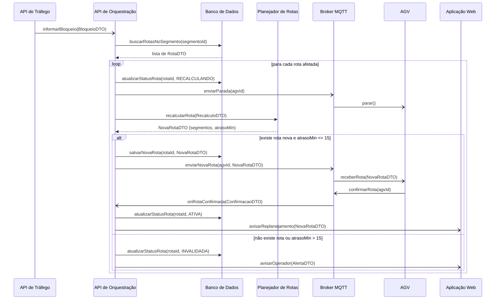
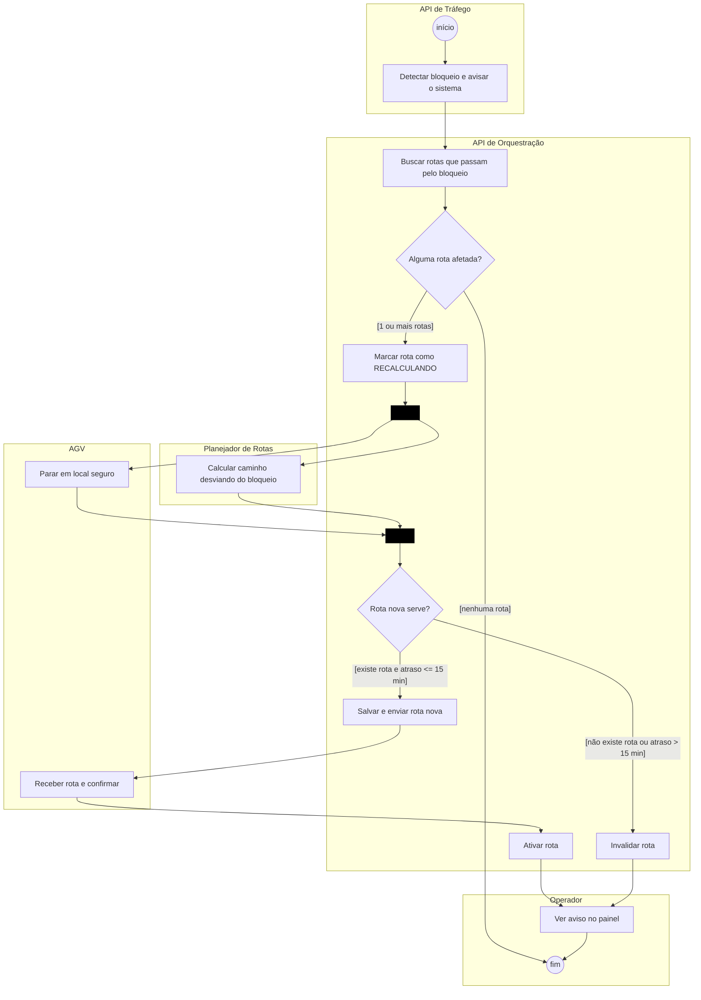
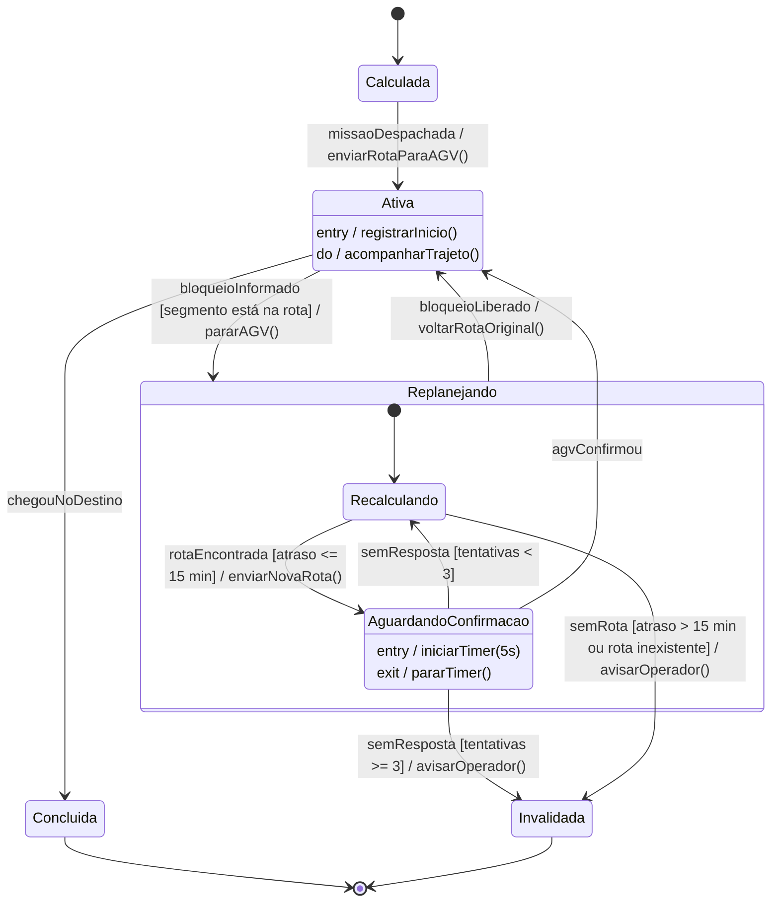
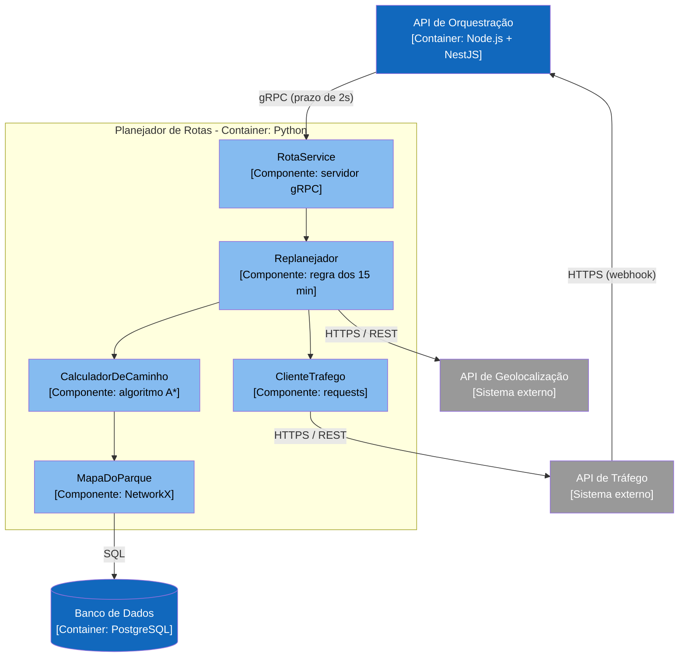

# APS 3 - Replanejamento de Rota por Bloqueio

**Aluna:** Heloyse Pereira
**Disciplina:** Modelagem de Software - Prof. Sidney L. da Silva
**Projeto:** Sistema de Logística de Entregas Autônomas (AGVs)

## A funcionalidade

A minha parte é o **replanejamento de rota**. Às vezes um corredor do parque fica bloqueado (uma empilhadeira parada, uma área interditada) enquanto um AGV está no meio da entrega. A API de Tráfego avisa o sistema e ele precisa:

1. descobrir quais rotas passam pelo trecho bloqueado;
2. mandar o AGV parar em um lugar seguro e, ao mesmo tempo, pedir uma rota nova para o Planejador de Rotas;
3. se a rota nova atrasar no máximo 15 minutos, enviar para o AGV e esperar ele confirmar;
4. se não tiver rota boa, ou o AGV não confirmar depois de 3 tentativas, a rota é invalidada e o operador é avisado.

Se o bloqueio for liberado no meio do processo, o AGV volta para a rota original.

## Operações de cada participante

- API de Orquestração: `informarBloqueio(BloqueioDTO)`, `onRotaConfirmada(ConfirmacaoDTO)`
- Banco de Dados: `buscarRotasNoSegmento(segmentoId)`, `atualizarStatusRota(rotaId, status)`, `salvarNovaRota(rotaId, NovaRotaDTO)`
- Planejador de Rotas: `recalcularRota(RecalculoDTO)`
- Broker MQTT: `enviarParada(agvId)`, `enviarNovaRota(agvId, NovaRotaDTO)`, `confirmarRota(agvId)`
- AGV: `parar()`, `receberRota(NovaRotaDTO)`
- Aplicação Web: `avisarReplanejamento(NovaRotaDTO)`, `avisarOperador(AlertaDTO)`

## Diagrama de Sequência

`->>` = síncrona (a chamada gRPC ao Planejador é síncrona), `-)` = assíncrona (webhook, MQTT, WebSocket), `-->>` = retorno.

## Diagrama de Atividades

O fork faz o AGV parar e o Planejador calcular ao mesmo tempo. O join garante que a rota nova só é enviada depois que o AGV já parou.

## Diagrama de Estados (Rota)

## C4 - Nível 3 (Planejador de Rotas)

## ADR

[ADR 0001 - Usar gRPC entre a API de Orquestração e o Planejador de Rotas](docs/architecture/adr-0001.md)

## Relação entre os diagramas

| O que acontece | Sequência | Estado da Rota |
|---|---|---|
| Bloqueio informado | `informarBloqueio()` | Ativa → Replanejando |
| Parar AGV + recalcular (fork) | `enviarParada()` e `recalcularRota()` | Recalculando |
| Rota nova enviada | `enviarNovaRota()` | Recalculando → AguardandoConfirmacao |
| AGV confirmou | `onRotaConfirmada()` | AguardandoConfirmacao → Ativa |
| Sem rota boa | `atualizarStatusRota(INVALIDADA)` | Recalculando → Invalidada |
